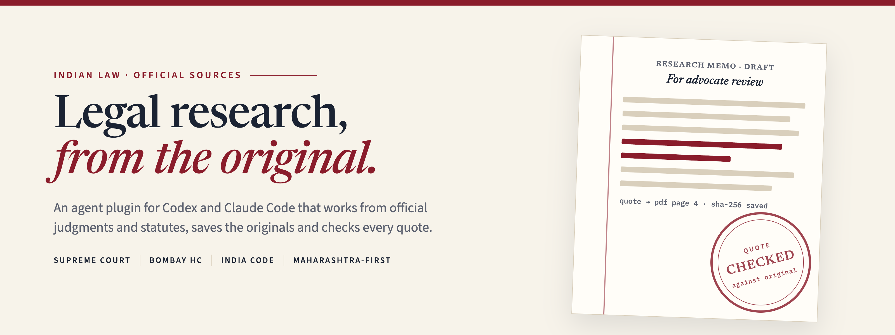
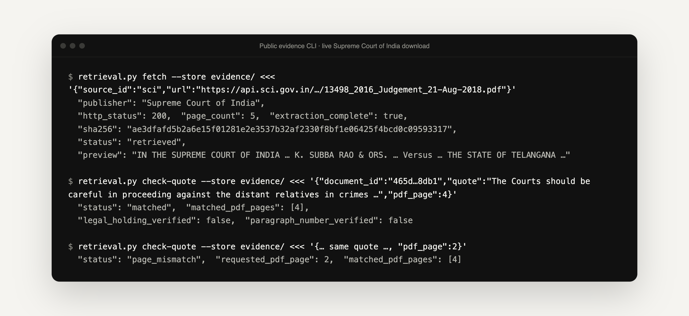

<p align="center">
  <picture>
    <source media="(prefers-color-scheme: dark)" srcset=".github/assets/banner-dark.png">
    
  </picture>
</p>

<p align="center">
  <strong>Research Indian law from the official record, not from memory.</strong><br>
  An Agent Skill and public-evidence toolset for Codex and Claude Code that helps Indian lawyers research, brief and draft from government and court originals, with <strong>Maharashtra civil, criminal and family practice</strong> first.
</p>

<p align="center">
  <a href="#install"><strong>Install</strong></a> ·
  <a href="#what-it-helps-with"><strong>Features</strong></a> ·
  <a href="plugins/indian-law/skills/indian-law/references/sources.json"><strong>Sources</strong></a> ·
  <a href="docs/efficacy-v2-report.md"><strong>Evaluation</strong></a> ·
  <a href="PRIVACY.md"><strong>Data handling</strong></a> ·
  <a href="CONTRIBUTING.md"><strong>Contribute</strong></a>
</p>

<p align="center">
  <a href="LICENSE"></a>
  
  
  <a href="https://github.com/mihirkavi/indian-law-official-sources/actions/workflows/ci.yml"></a>
</p>

> [!IMPORTANT]
> **Not legal advice.** This is a research and drafting aid for lawyers. A qualified advocate must review every interpretation, citation and draft before it is relied on or filed. It is not a government product, a certified legal database or a filing service, and an exact text match does not prove a legal holding, paragraph number or that the law is current.

<p align="center">
  
  <br><sub>A real run of the public-evidence CLI against a public Supreme Court of India judgment (output abridged). It keeps the original, records its hash and refuses a quote placed on the wrong page.</sub>
</p>

## Why Indian Law · Official Sources

General AI assistants can sound confident about Indian law while citing judgments they never read, sections that were renumbered under the BNS and BNSS, or blog summaries instead of the original.

**This plugin makes the assistant work from the official record.** It routes research to government and court sources, downloads the public original, keeps its origin, time and hash, and checks quotations word for word against the saved text. It then helps prepare research memos, judgment briefs and lawyer-review drafts with clear placeholders for missing facts.

<table>
  <tr>
    <td width="33%" valign="top">
      <h3>Official sources only</h3>
      India Code, gazettes, the Supreme Court, Bombay High Court, eCourts and Maharashtra departments. Commercial databases and blogs are deliberately excluded.
    </td>
    <td width="33%" valign="top">
      <h3>Every quote checked</h3>
      Saved originals with hashes, and exact quotation and page checks that reject wrong-page or absent text instead of "fixing" it.
    </td>
    <td width="33%" valign="top">
      <h3>Drafts a lawyer can finish</h3>
      Memos, briefs and pleadings, including a Bombay High Court s.528 BNSS quashing application as an editable Word file.
    </td>
  </tr>
</table>

## What it helps with

| | Capability | What it does |
| --- | --- | --- |
| I | **Official-source research** | Works from original government and court documents, keeping links, dates, pinpoints, provenance and gaps |
| II | **Judgment briefs** | Separates facts, issues, holdings, observations and relief, and verifies the original before claiming support |
| III | **Statute and version checks** | Amendments, commencement, exceptions, repeal and savings, and the law that applied on a given date |
| IV | **Civil, criminal and family drafting** | Lawyer-review outlines and drafts with placeholders for missing facts, keeping jurisdiction and personal-law distinctions |
| V | **Quashing applications (APL)** | Bombay High Court (Nagpur Bench by default) criminal application under s.528 BNSS, rendered from a house-format Word template with no client data |
| VI | **Case status and property research** | Routes to official court, CNR, revenue and registration services, and distinguishes orders, registry entries, mutations and title evidence |
| VII | **Languages** | Marathi, Hindi and English using the host model's own ability; generated translations are labelled |
| VIII | **Watchlists** | Configurable case and topic watchlists, manual by default; no scheduler is bundled |

## Install

Install [`uv`](https://docs.astral.sh/uv/getting-started/installation/) and put it on the AI host's PATH for the evidence tools (Python 3.10+; the offline helper runs on 3.9+).

**Claude Code**

```text
/plugin marketplace add mihirkavi/indian-law-official-sources
/plugin install indian-law@indian-law-local
```

**Codex**

```sh
codex plugin marketplace add mihirkavi/indian-law-official-sources --ref v0.3.0
codex plugin add indian-law@indian-law-local
```

Then invoke the `indian-law` skill (or `quashing-application`). To try it without installing, run `claude --plugin-dir plugins/indian-law` from a checkout.

<details>
<summary><strong>Local checkout and other Agent Skills hosts</strong></summary>
<br>

```sh
git clone https://github.com/mihirkavi/indian-law-official-sources.git
cd indian-law-official-sources
codex plugin marketplace add .
codex plugin add indian-law@indian-law-local
```

For another compatible host, import `plugins/indian-law/skills/indian-law` into its skill location; the release's skill ZIP contains that directory. The full plugin ZIP contains portable, Codex and Claude manifests. Manual MCP setup uses the installed absolute path to `scripts/retrieval_server.py`, and a shell-capable host can use the CLI when native MCP tools are absent.

The marketplace name `indian-law-local` is kept for compatibility with earlier installations. A public GitHub repository is not a listing in OpenAI's or Anthropic's plugin directories, and Claude Code instructions are not a promise of Claude web support.

</details>

## Try it

- *"Use indian-law to research this Maharashtra civil issue under the law applicable on [date]. Verify original sources and adverse authority; give a memo with links and pinpoints."*
- *"Brief [official judgment URL or citation]. Verify the caption, holding and relief, and disclose anything you cannot inspect."*
- *"Which procedure applies to an investigation pending before 1 July 2024? Check commencement and savings before mapping sections."*
- *"Use quashing-application to draft an APL under s.528 BNSS from the uploaded charge-sheet. Verify every authority and flag missing facts."*

More prompts and recorded runs are in [installed demonstrations](docs/installed-demo.md). They are usability smoke tests on public URLs, not efficacy comparisons.

## How it works

The **AI host** (Codex or Claude Code) supplies search, the browser, interpretation and language ability. **This repository** supplies the research workflows, official-source routing, templates and four evidence tools, available as a CLI or as local MCP tools:

| CLI command | MCP tool | What it does |
| --- | --- | --- |
| `sources` | `list_sources` | Lists the enabled official sources and their permitted hosts |
| `fetch` | `fetch_document` | Downloads a public HTTPS original into your evidence folder, with origin, time and hashes |
| `read` | `read_document` | Reads the saved text by query or PDF page |
| `check-quote` | `check_quote` | Checks an exact quotation and page against the saved text |

```sh
uv run --script plugins/indian-law/skills/indian-law/scripts/retrieval.py fetch --store /absolute/matter/evidence <<'EOF'
{"source_id": "sci", "url": "https://api.sci.gov.in/supremecourt/2016/13498/13498_2016_Judgement_21-Aug-2018.pdf"}
EOF
```

Every evidence operation needs an explicit folder you authorise. See [retrieval contracts and examples](plugins/indian-law/skills/indian-law/references/retrieval.md).

<details>
<summary><strong>Sources, sign-in and official APIs</strong></summary>
<br>

The [source inventory](plugins/indian-law/skills/indian-law/references/sources.json) records each publisher, its official provenance, current and legacy URLs, access, API assessment and review date. The [source audit](docs/source-audit.md) explains unresolved candidates. Sources include India Code, central and Maharashtra gazettes, the Supreme Court and e-SCR, Bombay High Court, eCourts and NJDG, Maharashtra law and home departments, MHA, DoLR/DILRMP, Mahabhumi and registration services. Directory entries are routes, not validated live connectors.

**No authenticated official API adapter is enabled.** eCourts and NJDG describe restricted institutional access, and public PDF hosting on `api.sci.gov.in` is not a judgment-search API. The tools use ordinary public HTTPS downloads.

Private sign-in is requested only when an operation truly needs it, such as a signed land-record download. A CAPTCHA, fee, HTTP 403 or timeout is not automatically a login requirement. You enter passwords and OTPs privately on the official service; this engine never handles credentials or cookies. Purchases, filing, registration changes and outgoing messages need their own authorisation.

</details>

<details>
<summary><strong>Evidence guarantees and their limits</strong></summary>
<br>

Downloads check source-specific HTTPS origins, every redirect and public DNS destinations, with byte and time limits. PDF extraction runs in a bounded subprocess; scans need a separate OCR workflow. Static HTML extraction does not run JavaScript, submit case searches or complete CAPTCHAs.

Saved hashes detect inconsistency, not malicious replacement of both evidence and metadata. PDF viewer pages are not printed page numbers. A matching quote may be a party's submission or a quote from another case, so read its context. No digital signature, certified copy, case identity, legal holding, currentness, citator coverage or title certification is guaranteed.

</details>

<details>
<summary><strong>Offline access and watchlist helper</strong></summary>
<br>

```sh
python3 plugins/indian-law/skills/indian-law/scripts/casework.py access < observation.json
python3 plugins/indian-law/skills/indian-law/scripts/casework.py compare < comparison.json
python3 plugins/indian-law/skills/indian-law/scripts/casework.py validate-watchlist < watchlist.json
```

`access` classifies observed facts; it does not verify supplied flags. `compare` keeps separate source and item baselines and retains the last successful observation after failed checks; an unchanged URL does not prove unchanged content. See the [monitoring guidance](plugins/indian-law/skills/indian-law/references/monitoring.md). No scheduler is bundled and no live monitor was activated during development.

</details>

<details>
<summary><strong>Quashing application (APL) builder</strong></summary>
<br>

```sh
uv run --script plugins/indian-law/skills/quashing-application/scripts/build_apl.py matter/apl-spec.json --out matter/APL-draft.docx
```

The skill reads the FIR and charge-sheet record, verifies statutes and judgments with the evidence tools, and writes a JSON matter spec shaped like the [synthetic example](plugins/indian-law/skills/quashing-application/assets/example-apl.json). The script renders it with the bundled [house template](plugins/indian-law/skills/quashing-application/assets/apl-template.docx), derived from a practising advocate's filing format (boxed cause title, Times New Roman 14 pt, double spacing, lettered grounds and prayers, solemn affirmation). It refuses to write into the plugin directory and reports numbered paragraphs, annexure labels and unresolved `[FACT REQUIRED …]` / `[TO BE CONFIRMED …]` placeholders.

The [drafting style](plugins/indian-law/skills/quashing-application/references/drafting-style.md), [analysis checklist](plugins/indian-law/skills/quashing-application/references/quashing-checklist.md) and [authorities checked on 2026-10-11](plugins/indian-law/skills/quashing-application/references/authorities.md) are bundled. The output is a lawyer-review draft, not a filing. Prospects, deponent authorisation and previous-proceedings statements need the advocate's instructions.

</details>

## Does it help?

A small [version 0.2 comparison](docs/efficacy-v2-report.md) used three frozen, human-selected topics in the same model and tool environment:

| Arm | Rubric points | Verified relevant case originals |
| --- | ---: | ---: |
| Ordinary AI, no plugin | 12/18 | 0 |
| Short official-source instruction | 12/18 | 0 |
| **Plugin 0.2** | **14/18** | **1** |

The gain was one public Supreme Court original, independently downloaded and verified. Correctness and calibration tied, and two local requests stayed unresolved. This small, partially blinded assessment is **not** evidence of generally better legal accuracy. The [earlier eight-task comparison](docs/efficacy-report.md) showed no benefit. Frozen prompts, answers, scores and rationale are under `eval/v2/`.

## Development

```sh
python3 -m venv .venv
.venv/bin/python -m pip install pypdf==6.20.0 mcp==2.3.0 python-docx==1.2.0
.venv/bin/python -m unittest discover -s tests -v
.venv/bin/python scripts/validate_package.py plugins/indian-law
.venv/bin/python scripts/build_release.py
```

88 tests cover package structure, the APL template, access and watchlist behaviour, guarded fetching, extraction, evidence integrity, quotation checks, documentation links and version consistency. CI repeats the hermetic checks; it does not certify legal accuracy or site availability. See [validation scope](docs/public-validation.md) and the [independent retrieval review](docs/retrieval-review.md).

## Honest status

**Experimental, version 0.3.0.**

- **Tested:** Codex installation, the CLI fallback, and an interactive Codex session that called the MCP tools to complete a quote-checked brief. Claude Code 2.1.295 validates, installs and loads the plugin, and a headless prompt called its MCP tools to produce a quote-checked judgment brief ([demonstrations](docs/installed-demo.md)).
- **Limits:** non-interactive Codex runs block the tools under the default approval policy, and the agent then declines rather than guessing. It does not work automatically in every AI app.
- No authenticated official API, OCR, CAPTCHA solving, scheduler or private court records.
- Evaluation is small and shows one retrieval gain, not better legal accuracy overall.
- Official websites change: an example MHA PDF link used in earlier docs now returns HTTP 404, so links in the source inventory need periodic review.

## Data, license and support

Read [data handling](PRIVACY.md), [contribution guidance](CONTRIBUTING.md) and [changes](CHANGELOG.md). The code and documentation are [MIT licensed](LICENSE); that does not relicense linked government records, legal documents, third-party dependencies or trademarks. Government records are not bundled, and no government affiliation is claimed.

Maintained by [Mihir Kavishwar](https://github.com/mihirkavi). Report reproducible public examples through [GitHub issues](https://github.com/mihirkavi/indian-law-official-sources/issues), without client files, identifiers or credentials.

<p align="center">
  <br>
  <sub><strong>Indian Law · Official Sources</strong> · Cite the original, every time.</sub>
</p>
